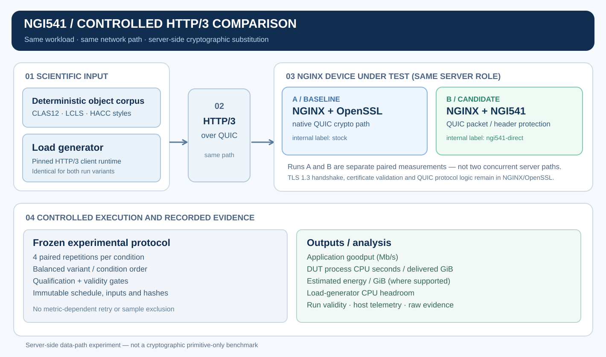

# NGI541 Benchmark Framework

[](https://github.com/ngi541/ngi541-benchmark-framework/actions/workflows/ci.yml)
[](LICENSE)
[](https://github.com/ngi541/ngi541)
[](https://doi.org/10.5281/zenodo.23407976)

[](https://doi.org/10.5281/zenodo.23407976)
[](https://doi.org/10.5281/zenodo.23407976)
[](https://doi.org/10.5281/zenodo.23407976)

*Published R6.5.4.5 controlled paired experiment — results scoped to the qualified, bandwidth-limited local deployment. [Explore the archived dataset and evidence](https://doi.org/10.5281/zenodo.23407976).*


**Reproducibility-first experimental framework for controlled measurement of cryptographic execution in network data paths.** Its implemented reference experiment measures the system-level effect of replacing **server-side NGINX QUIC packet and header protection** with the [NGI541](https://github.com/ngi541/ngi541) cryptographic execution engine, while preserving HTTP/3 workload and TLS protocol semantics.

The repository supplies executable NGINX integration patches, pinned dependencies, deterministic scientific object profiles, host/network qualification, balanced paired execution, telemetry, analysis and publication-artifact verification. It is **not** the NGI541 cryptographic library and does not report microbenchmark-only primitive throughput as application performance.

## Implemented comparison

| Controlled component | Baseline server | NGI541-integrated server |
| --- | --- | --- |
| NGINX / HTTP/3 / QUIC protocol implementation | NGINX | Same NGINX integration base |
| TLS 1.3 handshake, certificates and key derivation | OpenSSL | OpenSSL, unchanged in ownership |
| QUIC authenticated packet protection (AES-GCM) | Standard OpenSSL-backed QUIC crypto path | NGI541 direct prepared-key API |
| AES-based QUIC header-protection mask | Standard crypto path | NGI541 AES execution |
| Client and network path | Same pinned load generator and topology | Same |
| Scientific corpus and measurement protocol | Frozen before comparison | Identical frozen inputs and rules |

The internal configuration identifiers are **`stock`** (baseline OpenSSL/NGINX path) and **`ngi541-direct`** (NGI541-integrated server path). These are *separate, sequentially scheduled server configurations*, not concurrent backends serving half the traffic. The HTTP/3 client is not modified between pair members. NGINX/OpenSSL retain TLS 1.3 handshake and protocol state; only the specified server-side QUIC cryptographic operations are substituted.

## Measurement topology



The diagram distinguishes the controlled client/workload, the server-only cryptographic substitution, balanced experiment scheduling and the recorded measurements. A high-resolution [PNG version](docs/assets/framework-overview.png) is also available.

## Published experimental evidence

The accepted **R6.5.4.5 controlled paired HTTP/3 experiment** is publicly archived as a citable research dataset:

**[NGI541: Controlled Paired HTTP/3 Cryptographic Execution Benchmark Dataset (R6.5.4.5)](https://doi.org/10.5281/zenodo.23407976)**

**DOI:** [10.5281/zenodo.23407976](https://doi.org/10.5281/zenodo.23407976)

The archive contains the accepted publication bundle, frozen execution provenance, methodology, per-condition measurements, integrity information, three result visualizations, and the experimental topology. Under the qualified local deployment, the NGI541-integrated server path demonstrated lower CPU cost per delivered GiB while maintaining approximately equivalent application goodput.

| Metric | Local result | Interpretation |
| --- | --- | --- |
| DUT process CPU cost per delivered GiB | **approximately 8.216% lower** for `ngi541-direct` | Lower measured server CPU cost for the same delivered workload |
| Paired CPU-cost outcomes | **44 of 48 pairs** favored `ngi541-direct` | Direction of effect across valid matched observations; not a cross-platform claim |
| Application goodput | **approximately 0% difference** | Throughput was dominated by the qualified network envelope |
| Estimated energy per delivered GiB | **approximately 0.248% lower** | Small, estimate-based effect; not an external power-meter measurement |

**Evidence scope:** these numbers belong to the recorded, bandwidth-limited local DUT/load-generator execution; they are **not** high-speed datacenter, HPC, or ESnet performance claims. The exact experiment manifest, raw data, validity results and publication bundle are the authority for any formal quantitative statement.

The *frozen scientific protocol* is [`benchmark/protocols/http3-paired-r6.5.4.5.json`](benchmark/protocols/http3-paired-r6.5.4.5.json), SHA-256:

```text
99805dd378310ec539246e655d3f2a690036e4e50ac83c27c52765d1a50fb387
```

## Scientific data-movement workloads

The corpus is **not a bag of arbitrary random response sizes**. Deterministic generation follows three versioned, science-derived object-shape models:

| Workload model | Transfer shape represented | Profile definition |
| --- | --- | --- |
| **CLAS12 event-stream style** | Event-stream-oriented scientific objects | [`clas12-event-stream-v1.json`](benchmark/scientific-profiles/clas12-event-stream-v1.json) |
| **LCLS detector-frame style** | Detector-frame-oriented scientific objects | [`lcls-detector-frame-v1.json`](benchmark/scientific-profiles/lcls-detector-frame-v1.json) |
| **HACC multifile-dataset style** | Multi-object/multifile scientific dataset movement | [`hacc-multifile-dataset-v1.json`](benchmark/scientific-profiles/hacc-multifile-dataset-v1.json) |

These are **synthetic, reproducible representations inspired by scientific data-transfer characteristics**, not actual detector/HPC datasets, collaboration-certified traces or exhaustive domain validation. The frozen HACC execution repeats a selected planner subset; it is **not** a full-HACC-dataset claim. Their relevance is application delivery over encrypted transport, as in the high-throughput scientific-data-movement and Science DMZ/DTN setting described by [ESnet](https://fasterdata.es.net/science-dmz/); no ESnet deployment or measured equivalence is implied.

## Reproducibility and validity contract

| Control | Enforced behavior / failure condition |
| --- | --- |
| Workload selection | Calibrated **only against baseline** before NGI541 measurement; no candidate-driven tuning |
| Experimental identity | Frozen protocol and immutable input/schedule/runtime SHA-256 identities; deployment bindings recorded separately |
| Pairing | **4 paired repetitions per condition**, rotating condition order and balanced variant ordering |
| Transport validity | HTTP/3 with TLS 1.3, fixed AES-128-GCM cipher selection, peer verification, scientific-object correctness |
| Measurement integrity | **0 HTTP request failures** allowed; main-window selection excludes warm-up and readiness traffic |
| DUT/host validity | Throttling invalidates the run; nonblocking DUT sampling and thermal guards |
| Generator headroom | Aggregate CPU busy **≤85%**, busiest single core **≤95%** |
| Retries and outliers | **No metric-dependent automatic retry**; retain all structurally valid runs; append-only attempt evidence |
| Interpretation | Primary: application goodput (Mb/s), DUT process CPU seconds/delivered GiB; secondary: estimated energy/GiB and load-generator CPU headroom; within-condition median paired delta |

These controls address specific confounders and selection bias; they do not establish universal hardware or topology representativeness. See [methodology](docs/benchmark-methodology.md), [analysis](docs/analysis.md) and [reproducibility](docs/reproducibility.md).

## Reproduce the framework (no benchmark hardware required)

Clone and execute the standard-library test suite:

```bash
git clone https://github.com/ngi541/ngi541-benchmark-framework.git
cd ngi541-benchmark-framework
python3 -m unittest discover -s benchmark/framework/tests -p 'test_*.py'
python3 -m compileall -q benchmark
```

**What this proves:** schema/lifecycle, deployment identity, scientific corpus, HTTP/3 integration logic, paired-execution invariants, analysis and result-integrity tests pass. **What it does not prove:** an NGINX binary was built, network qualification succeeded, or a real performance measurement occurred.

Verify the accepted protocol bytes:

```bash
shasum -a 256 benchmark/protocols/http3-paired-r6.5.4.5.json
```

Portable experiment creation and schedule smoke (does not run a network benchmark):

```bash
./scripts/experiment.sh create \
  --deployment environments/local/single-host.json \
  --workload http3 \
  --variant stock \
  --variant ngi541-direct \
  --repetitions 2 \
  --comparison-mode paired-balanced

# Use the experiment ID printed on the first output line:
./scripts/experiment.sh plan <experiment-id>
./scripts/experiment.sh status <experiment-id>
```

**Result:** a source-control-ignored `experiments/<experiment-id>/` with normalized request, resolved definition and frozen planned run ordering. This is a *lifecycle smoke*, not the accepted four-repetition scientific campaign.

## Build and functional integration

The NGINX integration depends on an externally built, matching revision of the [NGI541 engine](https://github.com/ngi541/ngi541) and supported system build tools. Set its installation prefix explicitly:

```bash
./scripts/fetch-deps.sh
export NGI541_PREFIX=/absolute/path/to/ngi541/install
./scripts/build.sh
./scripts/test.sh
```

**Result:** pinned upstream dependencies are fetched; the integration is built against the supplied NGI541 installation; targeted NGINX/QUIC regression tests execute. This gate tests correctness, **not** benchmark speed. Refer to [integration model](docs/integration-model.md) for the precise ownership boundary.

## Reproduce the controlled two-host campaign

This path requires a **configured reference DUT and load-generator environment**, SSH/network access, runtime dependencies and the preserved qualification records. The retained versioned configs are **environment-specific execution definitions**, even though the scientific protocol is provider-independent; do not assume they work unmodified on arbitrary bare metal.

The stages must be executed in order. Every command yields machine-readable evidence consumed or validated by a later command; an upstream failure stops the campaign.

| Step | Executable command | Action → checked result |
| --- | --- | --- |
| `network-qualify` | `./scripts/experiment.sh network-qualify --config benchmark/configs/r6.5.1-pi-mac-network.json` (`--bootstrap` optional) | Checks DUT↔load-generator reachability and link capacity using ping/iperf3 → Network qualification records |
| `loadgen-runtime` | `./scripts/experiment.sh loadgen-runtime --config benchmark/configs/r6.5.4.2-pi-http3-loadgen.json` (`--bootstrap` optional) | Provisions the pinned HTTP/3 load-generator toolchain and validates versions, executable capabilities, patch/source SHA-256 and runtime identity → Qualified client runtime |
| `network-evidence` | `./scripts/experiment.sh network-evidence --config benchmark/configs/r6.5.3c-pi-mac-network-evidence.json` | Resolves qualified client and DUT link evidence and constructs a compatible service-capacity envelope. → Derived network envelope and compatibility evidence |
| `scientific-corpus` | `./scripts/experiment.sh scientific-corpus --config benchmark/configs/r6.5.3d-scientific-corpus.json` | Materializes deterministic scientific-object coverage from the versioned CLAS12, LCLS and HACC-inspired profiles. → Corpus manifest and object hashes |
| `transport-security` | `./scripts/experiment.sh transport-security --config benchmark/configs/r6.5.4.2-pi-mac-http3-security.json` | Runs HTTP/3/TLS 1.3 interoperability and scientific-object integrity checks for both server variants, including the required cipher suite and peer-verification policy. → Security/functional qualification |
| `dual-host-telemetry` | `./scripts/experiment.sh dual-host-telemetry --config benchmark/configs/r6.5.4.2-pi-mac-dual-host-telemetry.json` | Qualifies supported host sensors, sampling, readiness and thermal/throttling status across the DUT and remote load generator. → Capability and telemetry contracts |
| `workload-planner` | `./scripts/experiment.sh workload-planner --config benchmark/configs/r6.5.4.2-pi-mac-stock-workload-planner.json` | Selects a feasible request/concurrency workload using only the baseline NGINX/OpenSSL path and the qualified network envelope. → Frozen workload plan |
| `final-freeze` | `./scripts/experiment.sh final-freeze --config benchmark/configs/r6.5.4.2-pi-mac-final-freeze.json` | Checks upstream qualification identities and freezes schedule, input/corpus references, runtime artifact SHA-256 and validity policy. → Frozen manifest |
| `paired-execution` | `./scripts/experiment.sh paired-execution --config benchmark/configs/r6.5.4.5-pi-mac-paired-scientific-execution.json` | Executes baseline and candidate as separate balanced within-condition runs → Append-only raw attempts, paired records and analyzed experiment state. |

For full explanations of each gate, including exact commands, see [execution lifecycle](docs/experiment-lifecycle.md). After `paired-execution` has reached `COMPLETE`, independently validate and export its publication artifact:

```bash
./scripts/experiment.sh results \
  --experiment /absolute/path/to/complete-paired-execution
```

The command verifies the experiment identity, raw/processed consistency, paired analysis, validity evidence and output inventory, and writes under `artifacts/results/` (ignored by Git).

## Source layout

```text
benchmark/    current configs, scientific profiles, frozen protocol, framework, HTTP/3 adapter
integration/  NGINX and nghttp2 patches, versions, regression tests
scripts/      dependency, build, test and experiment entry points
environments/ deployment descriptors (provider/access identity is not scientific identity)
docs/         experiment contracts, methods, reproduction and interpretation
```

Generated `experiments/`, `qualifications/`, `corpora/`, `artifacts/` and build trees remain outside tracked source history. Consult [repository navigation](benchmark/README.md), [experiment schema](docs/experiment-schema.md) and [portability contract](docs/portability-contract.md).

## License

Licensed under the [Apache License, Version 2.0](LICENSE). The NGI541 engine is a separate repository with its own versioned source and license.
